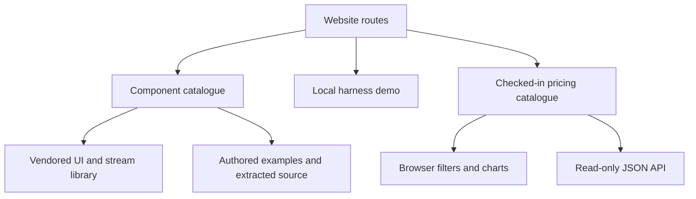

# Explore the website and its examples

Start with a component example or the model-price table. The site renders a vendored React library and authored examples; its harness is a local demonstration, and its pricing data is a source snapshot. It does not connect your chat to a model provider or make the listed prices current automatically.

| Task                                           | Read next                                                          |
| ---------------------------------------------- | ------------------------------------------------------------------ |
| Find a page or use the mobile menu             | [Navigation](navigation.md)                                        |
| Find a component, preview it and copy its code | [Component browser](components.md), [preview/source](previews.md)  |
| Identify every published component family      | [Registry inventory](inventory.md), [vendored library](library.md) |
| Try the full agent interface                   | [Harness](harness.md)                                              |
| Filter prices or benchmark boards              | [Price browser](pricing.md), [JSON API](pricing-api.md)            |
| Keep a light/dark preference                   | [Theme](theme.md)                                                  |
| Change the library or its examples             | [Source generation](authoring.md)                                  |
| Build and understand deployment boundaries     | [Build](build.md), [verification](verification.md)                 |

Courses, Research and Agents are visible coming-soon pages. They are not working course enrollment, research hosting or agent execution services. The atlas distinguishes source mapping, actual checks and bounded model results; no single passing model qualifies the entire website or upstream library.
