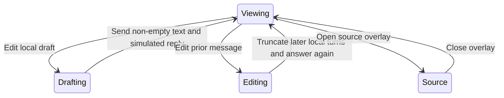

# Try the local agent interface

Open `/ui/harness` to try the full app composition. Select sample threads, arrange panes, browse files and use the example board, calendar, timeline and workflow surfaces. The source button opens an overlay with the extracted harness code and folding controls; close it to return to the same mounted harness.

Sending trims the draft, appends a local user turn and chooses an assistant reply from a fixed replies array. An empty draft is ignored. Editing/resending a turn keeps only earlier turns, replaces the edited user turn and appends a simulated streaming reply. These operations mutate React state; they do not call a model endpoint or save a durable conversation.

Switching the selected thread updates the view from its fixture turns. The demo includes local attachment/model/thinking/access choices, message selection, copy feedback, and sample data-tool controls; none establishes file-upload durability, authorization or provider execution. Treat labels as interface demonstrations. Reload/unmount can lose local edits.

The website owns this demo composition. The [vendored library](library.md) owns the underlying controls, and the source overlay is a separate presentation state from component-page tab replacement.
