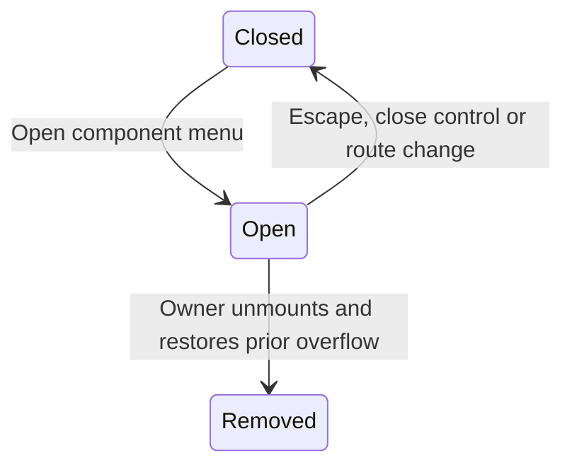

# Find a route and close the menu

Use the top navigation for Components, Tools, Courses, Research and Agents. The harness deliberately hides this site bar and supplies its own app surface. Unknown component slugs call Next’s notFound; route existence is not inferred from a similar name.

The documentation rail groups the registry’s eight component families. On small screens its button opens a drawer over the page. While open it sets body overflow to hidden, focuses the panel and listens for Escape. Closing or a pathname change removes that listener, restores the previously observed overflow style and returns focus to the trigger. This describes focus entry/return, not a claim of a complete focus trap or screen-reader qualification.

The site’s own responsive top menu lives in nav-bar.tsx; it is separate from the component drawer. Courses, Research and Agents explicitly say coming soon. Tools links to the implemented pricing table. External GitHub links leave this application; the site does not administer a repository or authenticate a provider.
