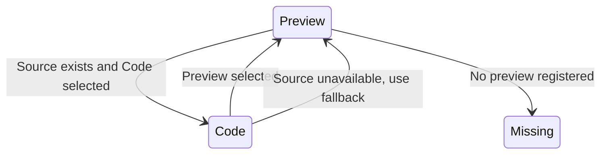

# Switch between a live preview and source

Open a component’s Preview and interact with it, then select Code. The tab displays source generated from the preview map and demo modules. When source is missing, Code is not offered and the renderer falls back to the preview; a missing preview displays “No preview registered”.

## Switching can discard demo state

The preview and code branches are conditionally rendered. Switching to code unmounts the preview, so local state in that demo is not preserved by the tab owner. Returning can recreate its initial data. The page is not a saved workspace.

SourceBlock folds nested regions and supports reset/all-fold controls. Its lightweight tokenizer is presentation, not a TypeScript compiler. The shared CodeSurfaceProvider supplies two Pierre highlight workers and five preloaded language names to library code surfaces; worker failures are not evidence that a source snippet was validated.

The extractor is a handwritten balanced-text/reference scanner, run before dev/build. It couples snippets to authored examples, but does not prove arbitrary JavaScript parsing, transitive imported helpers or standalone copy/paste compilation. Change the example source, regenerate and inspect the result; do not hand-edit generated snippets.

PreviewAvailability models source present/absent and the selected/rendered branch. Independent rendered-source evidence checks that code is shown only with source; a separate rule requires the selected Preview tab to render the preview. It excludes React lifecycle, source extraction, syntax validity and demo behavior.
