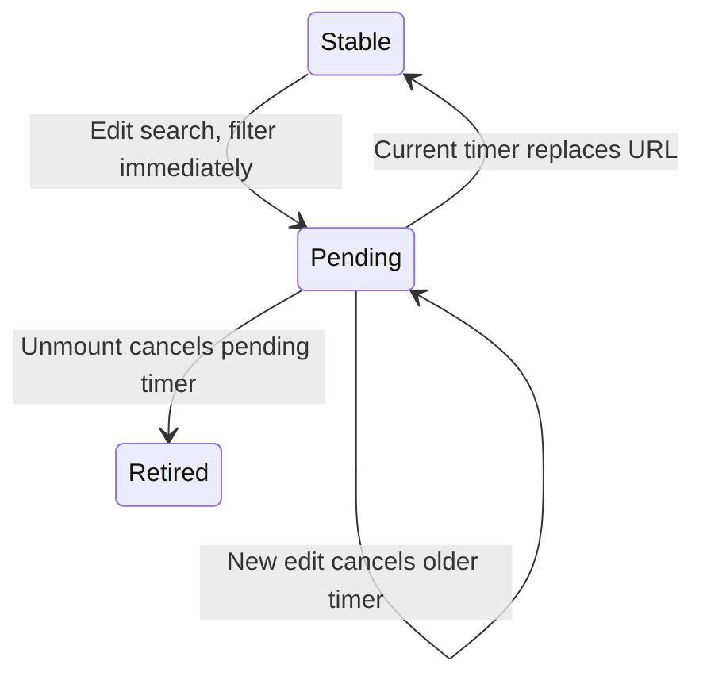

# Filter the price snapshot

Open Tools → Model API pricing. The catalogue’s declared update date is 2026-09-28 at this source checkpoint. Rates are checked-in USD values with units and conditional bands; the page does not fetch current vendor quotes. Use provider/category/search to compare the included rows, and read each unit/condition before comparing numbers.

Search changes the local filtered view immediately. After 200 ms without a newer effect, it replaces the URL query while retaining the other current parameters and avoiding a scroll reset. Effect cleanup cancels the pending timeout on another dependency change or unmount. An external URL update also resets the local search text. This is not a guarantee about cancellation of a router navigation already dispatched.

## Immediate filtering and delayed URL

The browser treats an unknown category as All and an unknown provider as no provider restriction. The JSON API instead refuses those inputs. Prices and Benches tabs share URL state; after mount the URL selects the view, while the server-provided initial view avoids an initial hydration disagreement. Graph selection and hover details are local presentation state.

Search first uses normalized names/IDs and small spelling/transposition tolerance; numeric version tokens still need a matching version fragment. Longer queries may also match score/benchmark notes. Missing score cells mean no published entry in this snapshot, not a score of zero or interchangeable measurements across boards. Gateway fee rows are separate from model rows and modelCount counts only provider models.

SearchTimer models two edits and retirement before a pending callback, with independently captured callback owner and current version. Controls keep an obsolete timer or allow a retired callback. It excludes router completion order, React scheduler timing, query parsing, ranking, prices and actual elapsed milliseconds.
