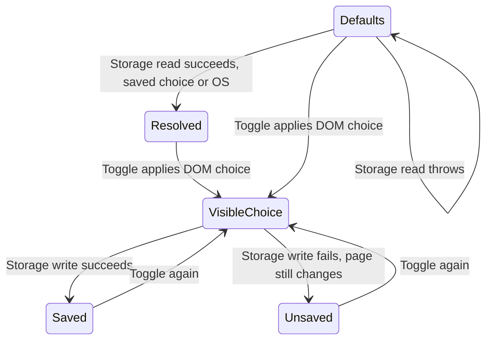

# Change the theme when storage is unavailable

Use Toggle theme to switch light/dark. The owner applies the same choice to root data-theme, the dark class and colorScheme, and passes it to code surfaces. It then tries to save `nessa-theme`; a storage exception is caught, so the current page still changes.

Before paint, the bootstrap script reads a valid saved choice or uses the OS preference. That OS fallback only runs if reading storage succeeds. If the read itself throws, the whole bootstrap try/catch leaves the root defaults unchanged. The mounted provider reads the resulting root class. It does not subscribe to subsequent OS theme changes.

## Visible choice and saved preference

If the choice reverts after a reload, inspect storage availability rather than assuming the button failed. Persistence is local to the browser origin; there is no server account setting or cross-tab synchronization in this owner. The toggle hides its icon until mount to keep server/client markup aligned.

ThemePublication models light/dark, independent root surfaces and optional persistence success for one toggle. It checks consistent visible surfaces and applies the requested theme despite a failed write. Negative controls update only one surface or gate visible application on persistence. Bootstrap, CSS contrast, media-query behavior and cross-tab races are excluded.
